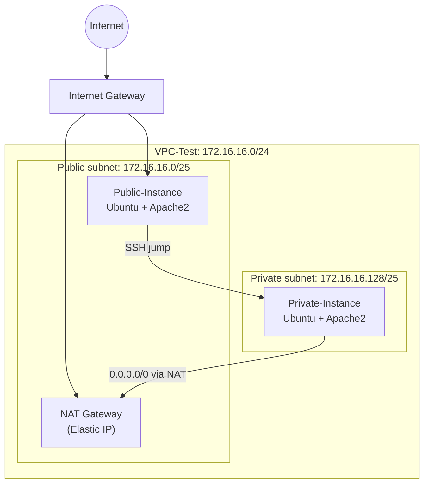

# Project 1: Custom VPC with Public/Private EC2 Instances and NACL Traffic Filtering

> **Region:** Europe (Stockholm) `eu-north-1` | **Services:** VPC, Subnets, Route Tables, Internet Gateway, NAT Gateway, EC2, Security Groups, Network ACLs

## Overview

This lab builds an isolated network from scratch and then restricts traffic inside it using **Network ACLs (NACLs)**. The VPC uses the CIDR block `172.16.16.0/24`, split into one public and one private subnet, each hosting an Apache web server on EC2.

### Requirements

1. Create a VPC (`172.16.16.0/24`) with one public and one private subnet.
2. Run one web server in each subnet (a public instance and a private instance).
3. **Block ICMP (ping) and SSH** from my own network's public IP to the public subnet.
4. **Block ICMP (ping)** from the private instance to the public instance.

## Architecture



| Component | Configuration |
|---|---|
| VPC | `VPC-Test`, `172.16.16.0/24`, no IPv6 |
| Public subnet | `sub-test-pub`, `172.16.16.0/25`, AZ `eu-north-1a` |
| Private subnet | `sub-test-priv`, `172.16.16.128/25`, AZ `eu-north-1a` |
| Internet Gateway | `Test-Internet-Gate`, attached to the VPC |
| NAT Gateway | `NAT-Test`, zonal, public connectivity, placed in the public subnet with an Elastic IP |
| Route tables | `Test-route-pub` (`0.0.0.0/0` → IGW), `Test-route-private` (`0.0.0.0/0` → NAT) |
| EC2 | Ubuntu Server LTS, `m7i-flex.large`, RSA `.pem` key pair |
| NACLs | `Test-Nacl-2` on the public subnet, custom NACL on the private subnet |

---

## Implementation

### 1. Create the VPC

Created the VPC with **VPC only**, name `VPC-Test`, manual IPv4 CIDR `172.16.16.0/24`, and no IPv6 block. All other options were left at their defaults.


### 2. Create the subnets

Two `/25` subnets split the VPC range into two 128-address blocks within the same Availability Zone.

| Subnet | CIDR | Purpose |
|---|---|---|
| `sub-test-pub` | `172.16.16.0/25` | Public web server |
| `sub-test-priv` | `172.16.16.128/25` | Private web server |


### 3. Launch the EC2 instances

| Setting | Public-Instance | Private-Instance |
|---|---|---|
| Subnet | `sub-test-pub` | `sub-test-priv` |
| Auto-assign public IP | **Enabled** | **Disabled** |
| Security group inbound | SSH (22), All ICMP-IPv4, HTTP (80) | SSH (22), HTTP (80) |


### 4. Internet access and routing

1. Created the internet gateway `Test-Internet-Gate` and attached it to `VPC-Test`.
2. Added `0.0.0.0/0 → Internet Gateway` to the **public** route table (`Test-route-pub`).
3. Created a separate **private** route table (`Test-route-private`) and explicitly associated it with `sub-test-priv`, so that the internet gateway route is **not** shared with the private subnet.


### 5. Configure the web servers

Connected to the public instance and installed Apache:

```bash
sudo apt update && sudo apt install apache2 -y
sudo systemctl start apache2
sudo systemctl enable apache2
```

Browsing to the instance's public IP returned the **Apache2 Ubuntu Default Page**.


### 6. NAT gateway for the private subnet

Created `NAT-Test` (zonal, public connectivity) inside the **public** subnet with an Elastic IP, then updated the private route table with `0.0.0.0/0 → NAT gateway`. This gives the private instance outbound-only internet access (for package installs) without exposing it to inbound connections.


### 7. Reach the private instance through the public instance

The private instance has no public IP, so it is accessed through the public instance (a jump host):

```bash
nano linux.key          # paste the .pem key contents
chmod 600 linux.key
ssh -i linux.key ubuntu@<private-instance-ip>
```

Then installed and enabled Apache on the private instance with the same commands as in step 5.


---

## Requirement A: Block ping and SSH from my network to the public subnet

**Before:** pinging the public instance from my Windows machine succeeded with 0% packet loss (average ≈ 183 ms).


I looked up my public IP and created a new NACL, `Test-Nacl-2`, associated with the public subnet. NACL rules are evaluated in ascending order of rule number, so the **deny rules use lower numbers than the allow-all rule**:

| Rule # | Type | Protocol / Port | Source | Action |
|---|---|---|---|---|
| 50 | All ICMP - IPv4 | ICMP | `<my-public-ip>/32` | **Deny** |
| 51 | SSH | TCP 22 | `<my-public-ip>/32` | **Deny** |
| 100 | All traffic | All | `0.0.0.0/0` | Allow |
| `*` | All traffic | All | `0.0.0.0/0` | Deny |


**After:** the same ping now returns `Request timed out` (4 sent, 0 received, **100% loss**), while the rest of the internet can still reach the web server on port 80.


---

## Requirement B: Block ping from the private instance to the public instance

**Before:** from the private instance, `ping <public-instance-private-ip>` succeeded with 0% loss and sub-millisecond latency.


I added deny rules for ICMP to the **private subnet's NACL**, in both directions, with a lower rule number than the allow-all rule:

| Direction | Rule # | Type | Source / Destination | Action |
|---|---|---|---|---|
| Inbound | 50 | All ICMP - IPv4 | `<public-instance-private-ip>/32` | **Deny** |
| Inbound | 100 | All traffic | `0.0.0.0/0` | Allow |
| Outbound | 50 | All ICMP - IPv4 | `<public-instance-private-ip>/32` | **Deny** |
| Outbound | 100 | All traffic | `0.0.0.0/0` | Allow |


**After:** `7 packets transmitted, 0 received, 100% packet loss`.


---

## Results

| # | Requirement | Result |
|---|---|---|
| 1 | VPC `172.16.16.0/24` with public and private subnets | Done |
| 2 | Web server in each subnet (public + private) | Done (Apache2) |
| 3 | Block ICMP and SSH from my IP to the public subnet | Done (ping timed out with 100% loss) |
| 4 | Block ICMP from the private instance to the public instance | Done (100% loss) |

## Key concepts demonstrated

- **Security groups are stateful allow-lists; NACLs are stateless and support explicit deny.** An explicit deny for a single IP is only possible with a NACL.
- NACL rule numbering and evaluation order (lowest match wins), and why the `*` rule denies everything unmatched.
- Public vs. private subnets are defined by their **route table**, not by their name.
- A NAT gateway provides outbound-only internet access for private resources.

## Security notes and improvements

This was a lab, so some settings were intentionally permissive. For a production-style setup I would:

- Restrict SSH (22) to a known admin IP instead of `0.0.0.0/0`.
- **Not copy the private `.pem` key onto the jump host.** Use SSH agent forwarding (`ssh -A`), `ProxyJump`, or **AWS Systems Manager Session Manager** instead.
- Mirror the NACL deny rules in the outbound direction as well, because NACLs are stateless.
- Delete the NAT gateway and release the Elastic IP after testing (NAT gateways are billed per hour).

## Clean-up

Terminate both instances → delete the NAT gateway → release the Elastic IP → detach and delete the internet gateway → delete custom NACLs, route tables and subnets → delete the VPC.
