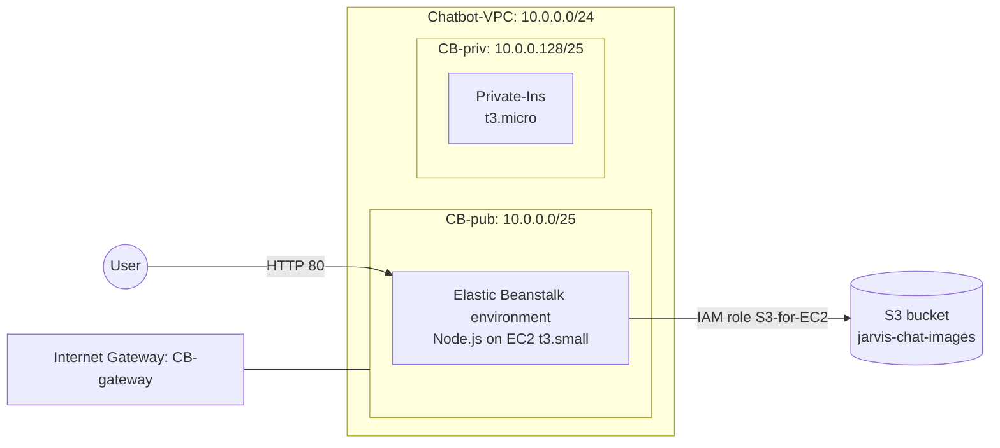

# Project 2: Deploying a Node.js Chatbot on Elastic Beanstalk with S3 Image Storage

> **Region:** Asia Pacific (Mumbai) `ap-south-1` | **Services:** VPC, Elastic Beanstalk, EC2, S3, IAM, NACLs, Security Groups

## Overview

This project deploys a Node.js chatbot web application (**JARVIS**) on **AWS Elastic Beanstalk** inside a custom VPC, and extends it so that images uploaded through the chat interface are stored in an **S3 bucket**. The EC2 instance accesses S3 through an **IAM role** rather than hard-coded credentials.

### Requirements

1. Create a VPC with public and private subnets, route tables and NACLs.
2. Launch instances in the private and public subnets; run the web application on the public side via Elastic Beanstalk.
3. Create an S3 bucket to store the application's images.
4. Use an IAM role to give the web server access to S3.
5. Block a specific IP address on the public subnet.

## Architecture



| Component | Configuration |
|---|---|
| VPC | `Chatbot-VPC`, `10.0.0.0/24` |
| Subnets | `CB-pub` `10.0.0.0/25`, `CB-priv` `10.0.0.128/25` |
| Internet Gateway | `CB-gateway` |
| Route tables | `Public-RT` (`0.0.0.0/0` → IGW), `Private-RT` (local only) |
| NACLs | `Public-NACL` (all traffic allowed), `Private-NACL` |
| Platform | Elastic Beanstalk, Node.js 24 on 64-bit Amazon Linux 2023 |
| Instance | `t3.small`, x86_64, 20 GiB gp3 root volume |
| Security group | `HTTP-SG1`: HTTP (80) and SSH (22) inbound |
| IAM role | `S3-for-EC2` (trusted entity: EC2) |
| Bucket | `jarvis-chat-images` |

---

## Implementation

### 1. Network foundation

Created `Chatbot-VPC` with one public and one private subnet, an internet gateway attached to the VPC, a public route table with a default route to the internet gateway, and a private route table with only the local route. Custom NACLs were then associated with each subnet (`Public-NACL` allows all traffic).


### 2. IAM policy and role for S3

Created a policy for S3 access and an IAM **role** with **EC2** as the trusted entity, attaching the S3 permissions. The role was named `S3-for-EC2` so the web server could call S3 using temporary credentials instead of access keys.


### 3. Deploy the chatbot with Elastic Beanstalk

- Application platform: **Node.js**, source uploaded as `Chatbot.zip`.
- Network: custom `Chatbot-VPC`, instance placed in the **public subnet** (`CB-pub`). A private subnet without a load balancer or NAT cannot be reached from the internet, so the web tier has to sit in the public subnet.
- Security group `HTTP-SG1` allows HTTP (80) from anywhere, plus SSH (22) for administration.

Beanstalk created the EC2 instance automatically, and the environment health turned **Ok**.


### 4. Verify instance access to S3

Connected to the instance over SSH and ran `aws s3 ls`:

- **Before attaching the role**: `AccessDenied` on `s3:ListAllMyBuckets` (the instance's default role has no S3 permissions).
- **After attaching `S3-for-EC2`** (EC2 → Actions → Security → Modify IAM role): the command listed the account's buckets successfully.


The application was then reachable at its Beanstalk domain and the chat interface worked.


### 5. S3 bucket for chat images

Created the bucket `jarvis-chat-images` and added:

**Bucket policy** (public read for objects under `uploads/` only):

```json
{
  "Version": "2012-10-17",
  "Statement": [
    {
      "Sid": "PublicReadUploads",
      "Effect": "Allow",
      "Principal": "*",
      "Action": "s3:GetObject",
      "Resource": "arn:aws:s3:::jarvis-chat-images/uploads/*"
    }
  ]
}
```

**CORS configuration**, so the browser app can load images from the bucket:

```json
[
  {
    "AllowedHeaders": ["*"],
    "AllowedMethods": ["GET", "HEAD"],
    "AllowedOrigins": ["http://<your-app>.ap-south-1.elasticbeanstalk.com"],
    "ExposeHeaders": ["ETag"],
    "MaxAgeSeconds": 3000
  }
]
```


### 6. Connect the app to the bucket

Added two **environment properties** in Beanstalk so the application knows where to store images:

| Key | Value |
|---|---|
| `AWS_REGION` | `ap-south-1` |
| `S3_BUCKET` | `jarvis-chat-images` |

Then updated the application source to add an **image upload option** to the chatbot (with supported image format handling) and redeployed it with **Upload and deploy**.


### 7. Test image upload end to end

Sent an image through the chatbot. The object appeared in the bucket under `uploads/` (stored as PNG with a unique timestamp-based prefix), and I confirmed it from the instance's terminal:

```bash
aws s3 ls s3://jarvis-chat-images/uploads/
aws s3 cp s3://jarvis-chat-images/uploads/<object-key> .
```


### 8. Block a specific IP on the public subnet

Edited the inbound rules of `Public-NACL` (rules with lower numbers are evaluated first):

| Rule # | Type | Source | Action |
|---|---|---|---|
| 50 | All ICMP - IPv4 | `100.100.100.100/32` | **Deny** |
| 51 | SSH (22) | `100.100.100.100/32` | **Deny** |
| 100 | All traffic | `0.0.0.0/0` | Allow |

Also launched `Private-Ins` (`t3.micro`) in the private subnet.


---

## Results

| # | Requirement | Result |
|---|---|---|
| 1 | Custom VPC with subnets, route tables, NACLs | Done |
| 2 | Chatbot web app running on Elastic Beanstalk (public subnet) | Done, environment health **Ok** |
| 3 | S3 bucket for application images | Done, uploads land in `uploads/` |
| 4 | IAM role granting EC2 access to S3 | Done, `aws s3 ls` went from `AccessDenied` to success |
| 5 | Block a specific IP on the public subnet | Done (NACL deny rules for ICMP and SSH) |

## Security notes and improvements

- **Least privilege:** the role used for the lab grants broad S3 access. In production, scope it to `s3:PutObject` / `s3:GetObject` on `arn:aws:s3:::jarvis-chat-images/uploads/*` only.
- **Attach to the Beanstalk instance profile:** swapping the instance's IAM role manually replaces the role Beanstalk assigned, and it is lost if the instance is replaced. The more durable approach is to add the S3 permissions to the environment's own instance profile.
- **Public read bucket policy:** limited to the `uploads/` prefix, but anything uploaded there is world-readable. For private content, serve images through pre-signed URLs or CloudFront instead.
- **CORS:** `AllowedOrigins` must include the scheme (`http://`) and have no trailing slash or path; `AllowedHeaders` takes header names (or `*`), not origins.
- **HTTPS and SSH:** serve the app over HTTPS (an Application Load Balancer with an ACM certificate) and restrict SSH to a trusted IP.
- **Secrets:** keep API keys out of the source code and repository; use Beanstalk environment properties or AWS Secrets Manager.

## Clean-up

Terminate the Beanstalk environment (and delete the application), empty and delete `jarvis-chat-images` and the auto-created `elasticbeanstalk-<region>-<account-id>` bucket, terminate `Private-Ins`, then delete the IAM role/policy and the VPC components.
