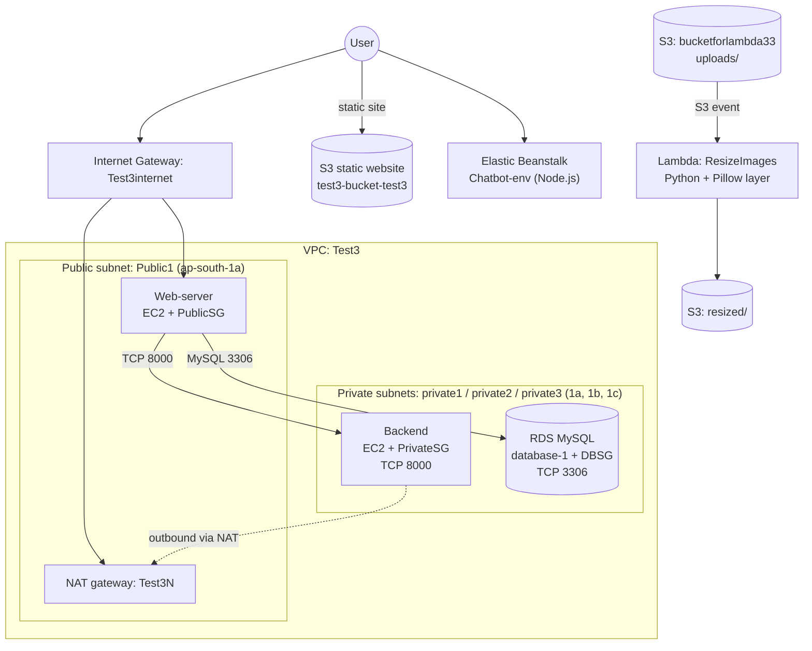

# Project 3: Secure Multi-Tier Web Architecture on AWS

> **Region:** Asia Pacific (Mumbai) `ap-south-1` | **Services:** VPC, EC2, Security Groups, IAM, S3, RDS (MySQL), Elastic Beanstalk, Lambda

## Overview

An end-to-end deployment that combines networking, access control, storage, a managed database, a dynamic application and serverless processing. It follows a classic multi-tier design: a public web tier, a private backend and database tier, and supporting AWS managed services.

### Tasks

| # | Task | Service(s) |
|---|---|---|
| 1 | Secure network with restricted access; backend reachable **only** through the web server | VPC, subnets, route tables, security groups |
| 2 | Fine-grained access control following security best practices | IAM |
| 3 | New user with storage permissions, then storage configuration | IAM, S3 |
| 4 | Host static assets on durable, scalable storage | S3 static website hosting |
| 5 | RDS database in a private subnet, accessed from the web server; create a table and insert records | RDS MySQL, EC2 |
| 6 | Deploy a dynamic backend application | Elastic Beanstalk |
| 7 | Resize uploaded images automatically and store them under a new name in the same bucket | Lambda, S3 |

## Architecture



---

## Implementation

### Task 1: Network design and tiered security groups

**VPC `Test3`** contains four subnets: one public (`Public1`, `ap-south-1a`) and three private (`private1` in `ap-south-1a`, `private2` in `ap-south-1b`, `private3` in `ap-south-1c`). Spreading private subnets across Availability Zones also satisfies the RDS requirement for a DB subnet group covering at least two AZs.

| Route table | Default route | Used by |
|---|---|---|
| `Publicroute` | `0.0.0.0/0` → internet gateway `Test3internet` | `Public1` |
| `Privateroute` | `0.0.0.0/0` → NAT gateway `Test3N` | Private subnets |


**Three security groups enforce tier-to-tier access:**

| Security group | Inbound rules | Purpose |
|---|---|---|
| `PublicSG` | HTTP (80), HTTPS (443), SSH (22) | Web server |
| `PrivateSG` | TCP 8000 (application port), SSH (22), allowed from the web tier | Backend server |
| `DBSG` | MySQL/Aurora (3306) with the **source set to `PublicSG`** | RDS database |

Because `DBSG` references `PublicSG` as its source rather than an IP range, only instances in the web tier can open database connections. The backend lives in a private subnet with no public IP, so it can only be reached from within the VPC.


**EC2 instances:**

| Name | Role | Type |
|---|---|---|
| `Web-server` | Web tier (public subnet) | `m7i-flex.large` |
| `Backend` | Application backend (private subnet) | `m7i-flex.large` |
| `Chatbot-env` | Created by Elastic Beanstalk for the dynamic app | `t3.micro` |


### Tasks 2 and 3: IAM user with storage permissions

Created the IAM user `Test3` with a console password and attached AWS-managed policies directly:

- `AmazonS3FilesFullAccess` (storage access)
- `IAMUserChangePassword` (lets the user rotate their own password)


> The IAM **role**-based approach (EC2 instance profile for S3 access) is demonstrated in [Project 2](../02-beanstalk-chatbot-s3/README.md).

### Task 4: Static website on S3

Uploaded the site (`index.html`, `error.html`, and `css/`, `images/`, `js/` folders) to the bucket `test3-bucket-test3` and enabled **S3 static website hosting**. The page loads over the bucket's website endpoint and the JavaScript button works, confirming that HTML, CSS and JS are all served from S3.


### Task 5: RDS MySQL in a private subnet, accessed via the web server

Created the RDS instance `database-1` (MySQL Community 8.4.9, `db.t3.micro`) inside the private subnets, protected by `DBSG`.


From the **web server** (the only host allowed through `DBSG`), I first tested connectivity and then opened a MySQL session:

```bash
sudo apt install mysql-client -y
timeout 5 nc -vz <rds-endpoint> 3306      # connection succeeded
mysql -h <rds-endpoint> -P 3306 -u admin -p
```

Created the `info` table and inserted two sample records:

```sql
CREATE TABLE info (
  name          VARCHAR(20),
  gender        VARCHAR(20),
  ph_no         INT,
  qualification VARCHAR(50),
  percentage    INT
);

INSERT INTO info VALUES ('<name1>', 'm', <phone1>, 'B.Tech', 70);
INSERT INTO info VALUES ('<name2>', 'm', <phone2>, 'B.Tech', 80);

SELECT * FROM info;   -- 2 rows in set
```


### Task 6: Dynamic application on Elastic Beanstalk

Deployed the JARVIS chatbot (Node.js 24 on Amazon Linux 2023) with Elastic Beanstalk as environment `Chatbot-env`. The environment reported **Health: Ok**, and the app is reachable from its Beanstalk URL with a working chat interface (text replies, image and voice inputs).


### Task 7: Automatic image resizing with Lambda

Created a Python Lambda function, `ResizeImages`, with an **S3 trigger**:

- **Pillow** is supplied through a **Lambda layer**, since it is not part of the default Python runtime.
- The function reads the bucket name and object key from the S3 event (keys are decoded with `unquote_plus` to handle spaces and special characters), downloads the image, scales it to fit within **800 × 800 px**, and writes the result back to the **same bucket** under `resized/` with a `resized_` filename prefix.

```python
import boto3
import os
from urllib.parse import unquote_plus
from PIL import Image

s3 = boto3.client("s3")

# Maximum dimensions of the resized image
MAX_WIDTH = 800
MAX_HEIGHT = 800

def lambda_handler(event, context):
    # Get bucket name and file key from S3 event
    ...
```


**Test:** uploaded images to `uploads/` in `bucketforlambda33`; the function ran automatically and created matching objects in `resized/`.

| Uploaded (`uploads/`) | Output (`resized/`) | Size after |
|---|---|---|
| `ProfilePhoto.png` (1.8 MB) | `resized_ProfilePhoto.png` | 754.1 KB |
| `Screenshot ... 160301.png` | `resized_Screenshot ... 160301.png` | 56.6 KB |
| `Screenshot ... 161307.png` | `resized_Screenshot ... 161307.png` | 44.6 KB |


---

## Results

| # | Task | Result |
|---|---|---|
| 1 | Tiered network; DB reachable only from the web tier | Done |
| 2/3 | IAM user with storage permissions | Done |
| 4 | Static website on S3 | Done |
| 5 | RDS in private subnet, table created, records inserted | Done |
| 6 | Dynamic app on Elastic Beanstalk | Done |
| 7 | Event-driven image resizing with Lambda | Done |

## Design notes and security considerations

- **Security group chaining** (`DBSG` → source `PublicSG`) is more robust than IP-based rules because it follows instances as their addresses change.
- **Avoid recursive Lambda triggers:** the function writes to the same bucket it reads from, so the S3 trigger must be scoped to the `uploads/` prefix; otherwise each resized image would invoke the function again.
- **Schema improvement:** store phone numbers as `VARCHAR`, not `INT` (leading zeros, country codes and longer numbers do not fit an integer). For real data, use a least-privilege DB user instead of `admin`.
- **IAM hardening:** enable **MFA** on the console user, grant only the specific S3 actions and buckets required, and avoid long-lived access keys.
- **SSH exposure:** restrict port 22 to a trusted IP, or use **Session Manager** and remove SSH rules entirely.
- **Static website:** S3 website endpoints serve HTTP only; put **CloudFront** with an ACM certificate in front for HTTPS.
- **Cost:** NAT gateways, RDS and EC2 are billed while running. Stop or delete resources after the demo.

## Clean-up

Delete the Lambda function and layer, empty and delete both buckets, terminate the Beanstalk environment, delete the RDS instance (skip the final snapshot for a lab), terminate the EC2 instances, remove the NAT gateway and release its Elastic IP, then delete the security groups, route tables, internet gateway, subnets, VPC and the IAM user.
